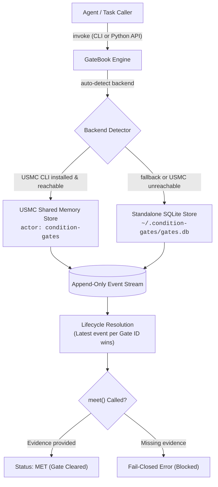
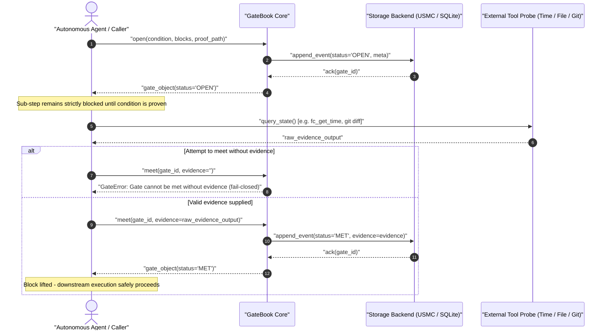

# condition-gates

<p align="center">
  <a href="https://github.com/ellmos-ai/condition-gates"></a>
  <a href="LICENSE"></a>
  <a href="https://github.com/ellmos-ai/condition-gates/actions/workflows/ci.yml"></a>
  <a href="tests"></a>
  <a href="https://github.com/astral-sh/ruff"></a>
  <a href="#storage-detect-it-otherwise-create-it"></a>
  <a href="#append-only"></a>
  <a href="#governance-and-runtime-invariants"></a>
  <a href="#evidence-requirement"></a>
  <a href="llms.txt"></a>
  <a href="https://github.com/ellmos-ai"></a>
  <a href="https://github.com/open-bricks"></a>
  <a href="PRIVATE.txt"></a>
</p>

<p align="center"><strong>English</strong> · <a href="README_de.md">Deutsch</a></p>

Conditions as **gates**: a sub-step stays blocked until its condition is **proven** met by a
tool query. Gates survive the end of a session and an abort.

Family: `.ORCHESTRATION` · Type: `library` (CLI + Python API) · Consumer: Skill `condition`

Canonical source: private repository `https://github.com/ellmos-ai/condition-gates`.
This does not authorize a public release.

---

### Quick Navigation

- [Purpose](#purpose)
- [System Architecture](#system-architecture)
- [Lifecycle Sequence](#lifecycle-sequence)
- [Storage: detect it, otherwise create it](#storage-detect-it-otherwise-create-it)
- [Append-only](#append-only)
- [CLI](#cli)
- [Machine-readable output](#machine-readable-output)
- [Python](#python)
- [Evidence requirement](#evidence-requirement)
- [Governance and Runtime Invariants](#governance-and-runtime-invariants)
- [Ecosystem and Sister Modules](#ecosystem-and-sister-modules)
- [Delimitation from the lock system](#delimitation-from-the-lock-system)
- [Limits](#limits)
- [Testing and Verification](#testing-and-verification)
- [License](#license)

---

## Purpose

Conditions written in prose get lost. "Only use swarm-ai from 6 a.m." sits on line 40 of an
assignment, the agent reads it at 3 a.m., starts working and remembers nothing of it at 6 a.m.
This module turns that into a named object with a lifecycle — and enforces a proof when it is
closed.

## System Architecture



## Lifecycle Sequence



## Storage: detect it, otherwise create it

Two backends behind one interface, selected automatically:

| Backend | when | where |
|---|---|---|
| **USMC** | if the `usmc` CLI is present **and reachable** | shared working memory under the vendor-neutral default actor `condition-gates` |
| **SQLite** | otherwise — fallback without any foreign dependency | `~/.condition-gates/gates.db`, file and table are created on demand |

The fallback is silent on purpose: a missing USMC is not an error but a host without that
service. If USMC is installed but broken, that is reported on stderr and evaded anyway — a
broken store must not halt the work. Every output states which backend won; `doctor` shows it
explicitly.

Anything can be forced:

```bash
CONDITION_GATES_BACKEND=sqlite
CONDITION_GATES_DB=<path>          # sqlite only
CONDITION_GATES_AGENT=<agent-id>   # USMC only; default: condition-gates
```

## Append-only

A status change appends a **new** record instead of altering the old one; per gate ID the most
recent one applies. With USMC this is enforced (individual working entries cannot be deleted),
with the SQLite backend it is deliberately kept the same — that way both behave identically and
the history including its evidence stays readable.

## CLI

```bash
python -m condition_gates doctor [--json]            # backend detection + inventory
python -m condition_gates list [--all] [--json]      # default: open ones only
python -m condition_gates open "<condition>" --blocks "<what is blocked>" --proof "<proof path>" [--json]
python -m condition_gates meet <id> --evidence "<proof text from the tool query>" [--json]
python -m condition_gates drop <id> --reason "<why it is moot>" [--json]
```

Exit codes: `0` ok · `1` domain error (e.g. missing evidence) · `2` gate not found.

## Machine-readable output

Every command accepts `--json`. Backend metadata always has the same separate location;
command data is stored under `gates`, `gate`, `diagnostics`, or `error`:

```json
{
  "meta": {
    "backend": "sqlite",
    "backend_description": "SQLite (<path>)"
  },
  "gates": []
}
```

Successful JSON is written to stdout; JSON errors are written to stderr and preserve the
documented exit codes.

## Python

```python
from condition_gates import GateBook
book = GateBook()                      # backend automatic
g = book.open("system time >= 06:00", blocks="report-job", proof="time-probe")
[x for x in book.list() if x.is_open]
book.meet(g["gate_id"], "time-probe: 06:16 Europe/Berlin")
```

## Evidence requirement

`meet()` without evidence fails — that is intentional and the actual value of the module. A gate
that counts as met without being checked is worse than no gate at all: it creates trust in an
order that was never kept. What qualifies as proof is decided by the caller (time via
`fc_get_time`, files via `fc_list_directory`, repository state via `git` …); the module only
enforces that one is named at all. Which time, file or version control tool delivers the proof
is decided by the respective agent or host.

## Governance and Runtime Invariants

The module guarantees the following deterministic runtime invariants across all platforms:

- **`INV-GATE-01` — Immutable Append-Only History**: Every state transition (`open`, `meet`, `drop`) appends a new event record. Prior states are never overwritten or deleted.
- **`INV-GATE-02` — Mandatory Empirical Evidence**: A gate cannot transition to `MET` without non-empty evidence provided by the caller. Closing a gate without proof fails closed.
- **`INV-GATE-03` — Resilient Dual-Backend Auto-Detection**: Uses USMC working memory when installed and responding; transparently falls back to local SQLite if USMC is missing or unresponsive.
- **`INV-GATE-04` — Zero Network Egress**: The module is 100% local-first and self-contained; it never performs external network calls, telemetry, or remote state synchronizations.
- **`INV-GATE-05` — Deterministic CLI Exit Code Contract**: Strict exit codes (`0` = Success, `1` = Domain/Validation Error, `2` = Gate Not Found).
- **`INV-GATE-06` — Dual-Stream Machine-Readable JSON Contract**: Standardized JSON envelope with segregated `meta` and command payload. Successful responses go to `stdout`, errors to `stderr`.
- **`INV-GATE-07` — Separation of Management vs. Evaluation**: Gates manage and audit precondition lifecycles, while the logic for condition evaluation is decoupled and owned by calling skills/agents.
- **`INV-GATE-08` — Private Repository Boundary**: Strictly bound by `PRIVATE.txt`; no unauthorized public releases, external mirrors, or public package deployments.

## Ecosystem and Sister Modules

| Module / Repository | Responsibility | Integration with `condition-gates` |
|---|---|---|
| `ellmos-ai/condition-gates` | Sub-step condition tracking & proof enforcement | **This module** (Core library & CLI) |
| `ellmos-ai/lock-master` | Multi-agent file & directory lock coordinator (`LOCK.*`) | Complementary: locks hold **other** actors away; gates block **self** |
| `ellmos-ai/hook-master` | Policy enforcement & agent consent gates | Cross-verifies system-wide governance hooks |
| `ellmos-ai/usmc` | Universal Shared Memory Core | Primary backend for cross-agent condition visibility |
| `ellmos-ai/memoryhooker` | Persistent context & memory retrieval | Contextual recall of gate histories and proofs |
| `ellmos-ai/system-gap-master` | Gap analysis & system state validation | Evaluates prerequisite capabilities before setting gates |
| `ellmos-ai/source-resolver` | Cross-host source of truth resolution | Validates canonical file paths used in proof paths |
| `open-bricks` | Umbrella organization & software distribution | Architectural umbrella for modular AI engineering |

## Delimitation from the lock system

`lock-master` already knows a **condition lock** (`lock_create.py --condition
--release-condition "…"`). That is something different, and the separation is intentional:

| | `lock-master --condition` | `condition-gates` |
|---|---|---|
| Whom does it hold up? | **other** agents and systems | **myself** — my own sub-step |
| Subject | a directory / work area | a sub-goal within an assignment |
| Condition | free text, read by humans | translated into checkable form, with a named proof path |
| Resolution | lock file is removed | `meet` with evidence from a tool query |

They complement each other: if a gate should additionally keep **others** away, `lock-master` is
called for that — it is not rebuilt here.

## Limits

- The module does **not check conditions itself**. It manages them. The checking and the behaviour
  on open gates (reordering, resolving blockers, putting them to sleep) is described by the skill `condition`.
- **Concurrency is not this module's business.** Two processes writing at the same time could
  advance the same gate twice. A dedicated locking mechanism, however, explicitly does **not** belong
  in an encapsulated module: on this system one has long been present and running with `lock-master`
  (`control.locks`) — if parallel operation becomes relevant, it is called directly
  (`lock_create.py <dir> --scope gates`), not rebuilt here. That is why `control.locks` is in the
  manifest under `optional`: a capability this module uses when it is there, and does not bring
  along itself.

  A stack composition is not needed for that on this system — both building blocks are installed.
  One would only make sense once somebody wants to rebuild the assembly **from the outside**, without
  existing memory and without a locker.

## Testing and Verification

```bash
# Run pytest test suite including contract & metadata tests
python -m pytest tests/ -v

# Code style and linting
python -m ruff check .

# Syntax check
python -m compileall -q .

# Mermaid diagram syntax check
python -m lint_mermaid .
```

## Security and Governance

- **Security Policy:** See [SECURITY.md](SECURITY.md) for vulnerability disclosure procedures, 48-hour response SLA, and architectural invariants.
- **Third-Party Licenses & SBOM:** See [THIRD_PARTY_LICENSES.md](THIRD_PARTY_LICENSES.md) for the runtime dependency inventory (0 external dependencies, 100% Python Standard Library PSF-2.0), unprivileged `RunAsInvoker` execution model, and system invariants.
- **CI Automation:** Multi-OS CI matrix across Ubuntu and Windows on Python 3.10, 3.11, 3.12, and 3.13 (`.github/workflows/ci.yml`).

## License

MIT License — see [LICENSE](LICENSE) for details.
