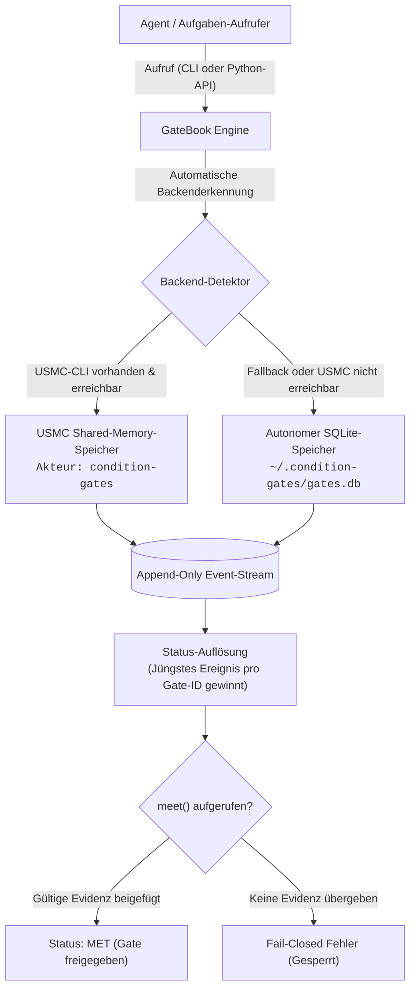
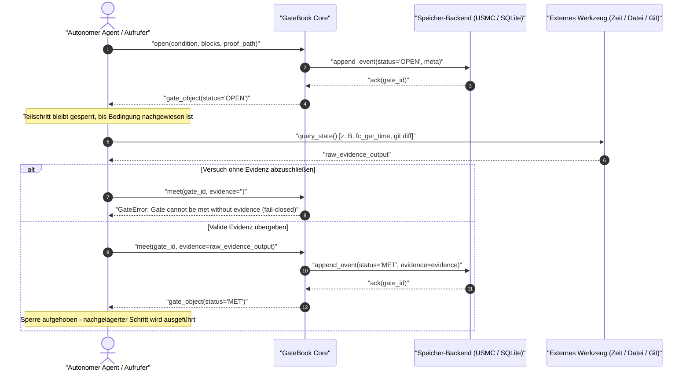

# condition-gates

<p align="center">
  <a href="https://github.com/ellmos-ai/condition-gates"></a>
  <a href="LICENSE"></a>
  <a href="https://github.com/ellmos-ai/condition-gates/actions/workflows/ci.yml"></a>
  <a href="tests"></a>
  <a href="https://github.com/astral-sh/ruff"></a>
  <a href="#speicher-erkennen-sonst-selbst-anlegen"></a>
  <a href="#append-only"></a>
  <a href="#governance-und-laufzeit-invarianten"></a>
  <a href="#evidenzpflicht"></a>
  <a href="llms.txt"></a>
  <a href="https://github.com/ellmos-ai"></a>
  <a href="https://github.com/open-bricks"></a>
  <a href="PRIVATE.txt"></a>
</p>

<p align="center"><a href="README.md">English</a> · <strong>Deutsch</strong></p>

Bedingungen als **Gates**: Ein Teilschritt bleibt gesperrt, bis seine Bedingung durch eine
Werkzeugabfrage **belegt** erfüllt ist. Gates überleben Session-Ende und Abbruch.

Familie: `.ORCHESTRATION` · Art: `library` (CLI + Python-API) · Konsument: Skill `condition`

Kanonische Quelle: privates Repository `https://github.com/ellmos-ai/condition-gates`.
Dies ist keine Freigabe für eine öffentliche Veröffentlichung.

---

### Schnellnavigation

- [Wozu](#wozu)
- [Systemarchitektur](#systemarchitektur)
- [Lebenszyklus-Sequenz](#lebenszyklus-sequenz)
- [Speicher: erkennen, sonst selbst anlegen](#speicher-erkennen-sonst-selbst-anlegen)
- [Append-only](#append-only)
- [CLI](#cli)
- [Maschinenlesbare Ausgabe](#maschinenlesbare-ausgabe)
- [Python](#python)
- [Evidenzpflicht](#evidenzpflicht)
- [Governance und Laufzeit-Invarianten](#governance-und-laufzeit-invarianten)
- [Ökosystem und Geschwistermodule](#ökosystem-und-geschwistermodule)
- [Abgrenzung zum Lock-System](#abgrenzung-zum-lock-system)
- [Grenzen](#grenzen)
- [Testen und Verifikation](#testen-und-verifikation)
- [Lizenz](#lizenz)

---

## Wozu

Bedingungen in Fließtext gehen verloren. „Setz swarm-ai erst ab 6 Uhr ein" steht in Zeile 40 eines
Auftrags, der Agent liest es um 3 Uhr, arbeitet los und erinnert sich um 6 Uhr an nichts mehr.
Dieses Modul macht daraus ein benanntes Objekt mit Lebenszyklus — und erzwingt beim Schließen
einen Beleg.

## Systemarchitektur



## Lebenszyklus-Sequenz



## Speicher: erkennen, sonst selbst anlegen

Zwei Backends hinter einer Schnittstelle, Auswahl automatisch:

| Backend | wann | wo |
|---|---|---|
| **USMC** | wenn die `usmc`-CLI vorhanden **und erreichbar** ist | gemeinsames Working-Memory unter dem anbieterneutralen Standard-Akteur `condition-gates` |
| **SQLite** | sonst — Fallback ohne jede Fremdabhängigkeit | `~/.condition-gates/gates.db`, Datei und Tabelle werden bei Bedarf selbst angelegt |

Der Fallback ist absichtlich still: Ein fehlendes USMC ist kein Fehler, sondern ein Host ohne
diesen Dienst. Ein nicht erreichbarer USMC-Transport wird vor dem SQLite-Fallback auf stderr
gemeldet. Erkannte Datenfehler in Gate-Datensätzen stoppen das Laden und wählen nie automatisch
einen leeren SQLite-Speicher. Welches Backend gewonnen hat, sagt jede Ausgabe; `doctor` zeigt es
explizit.

Erzwingen lässt sich alles:

```bash
CONDITION_GATES_BACKEND=sqlite
CONDITION_GATES_DB=<path>          # sqlite only
CONDITION_GATES_AGENT=<agent-id>   # USMC only; default: condition-gates
```

## Append-only

Ein Statuswechsel hängt einen **neuen** Datensatz an, statt den alten zu ändern; pro Gate-ID gilt
der jüngste. Bei USMC ist das erzwungen (einzelne Working-Einträge lassen sich nicht löschen),
beim SQLite-Backend bewusst gleich gehalten — so verhalten sich beide identisch und die Historie
samt Evidenz bleibt lesbar.

Neue USMC-Notizen verwenden `GATE g1 | format=json-v1 | status=OFFEN | ...`. Textfelder
sind JSON-Zeichenketten; senkrechte Striche werden als `\u007c` und Zeilenumbrüche als
Escape-Sequenzen geschrieben. Texte und Gate-IDs bleiben dadurch beim Rundlauf unverändert
und können keine Statusfelder werden. Eindeutige Altbestände bleiben lesbar. Doppelte Felder,
unbekannte Statuswerte oder Formatversionen und beschädigte neue Werte sind Datenfehler;
sie erfordern eine Prüfung statt eines geratenen Gate-Zustands. Solche Fehler stoppen das
Laden und wählen nicht automatisch einen leeren SQLite-Speicher.

Zuerst die Leser aktualisieren, danach neue Schreiber aktivieren: Alte Leser dekodieren
die JSON-Textwerte nicht. Bestehende USMC-Notizen werden nicht umgeschrieben und mehrdeutige
Altbestände nicht automatisch repariert. Diese Integrationsanforderung bedeutet keinen
automatischen Rollout durch die Quelländerung.

## CLI

```bash
python -m condition_gates doctor [--json]            # backend detection + inventory
python -m condition_gates list [--all] [--json]      # default: open ones only
python -m condition_gates open "<condition>" --blocks "<what is blocked>" --proof "<proof path>" [--json]
python -m condition_gates meet <id> --evidence "<proof text from the tool query>" [--json]
python -m condition_gates drop <id> --reason "<why it is moot>" [--json]
```

Exit-Codes: `0` ok · `1` fachlicher Fehler (z. B. fehlende Evidenz) · `2` Gate nicht gefunden.

## Maschinenlesbare Ausgabe

Jeder Befehl akzeptiert `--json`. Die Backend-Metadaten stehen immer getrennt an derselben
Stelle; Befehlsdaten liegen unter `gates`, `gate`, `diagnostics` oder `error`:

```json
{
  "meta": {
    "backend": "sqlite",
    "backend_description": "SQLite (<path>)"
  },
  "gates": []
}
```

Erfolgreiches JSON wird nach stdout geschrieben; JSON-Fehler gehen nach stderr und behalten
die dokumentierten Exit-Codes bei.

## Python

```python
from condition_gates import GateBook
book = GateBook()                      # Backend automatisch
g = book.open("Systemzeit >= 06:00", blocks="report-job", proof="time-probe")
[x for x in book.list() if x.is_open]
book.meet(g["gate_id"], "time-probe: 06:16 Europe/Berlin")
```

## Evidenzpflicht

`meet()` ohne Evidenz schlägt fehl — das ist Absicht und der eigentliche Wert des Moduls. Ein Gate,
das ungeprüft als erfüllt gilt, ist schlimmer als gar keins: Es erzeugt Vertrauen in eine
Reihenfolge, die nie eingehalten wurde. Was als Beleg taugt, entscheidet der Aufrufer (Zeit via
`fc_get_time`, Dateien via `fc_list_directory`, Repo-Zustand via `git` …); das Modul erzwingt nur,
dass überhaupt einer genannt wird. Welches Zeit-, Datei- oder Versionskontrollwerkzeug den
Beleg liefert, entscheidet der jeweilige Agent oder Host.

## Governance und Laufzeit-Invarianten

Das Modul garantiert plattformübergreifend folgende deterministische Laufzeit-Invarianten:

- **`INV-GATE-01` — Unveränderliche Append-Only Historie**: Jeder Zustandswechsel (`open`, `meet`, `drop`) hängt ein neues Ereignis an. Bestehende Daten werden weder überschrieben noch gelöscht.
- **`INV-GATE-02` — Obligatorische Empirische Evidenz**: Ein Gate kann nicht ohne nicht-leere Evidenz in den Status `MET` übergehen. Ein Abschlussversuch ohne Beweis schlägt fehl (Fail-Closed).
- **`INV-GATE-03` — Resiliente Backend-Autodetektion**: Nutzt bevorzugt den USMC-Arbeitsspeicher; weicht bei Nichtverfügbarkeit oder Fehlern transparent und lautlos auf eine lokale SQLite-Datenbank aus.
- **`INV-GATE-04` — Null Netzwerk-Egress (Zero-Egress)**: 100 % lokal und autark; keinerlei Netzwerkaufrufe, Telemetrie oder externe Synchronisationsprozesse.
- **`INV-GATE-05` — Deterministischer CLI-Exit-Code-Vertrag**: Verbindliche Exit-Codes (`0` = Erfolg, `1` = Fachlicher Validierungsfehler, `2` = Gate nicht gefunden).
- **`INV-GATE-06` — Maschinenlesbarer JSON-Vertrag**: Strikte Trennung von `meta`-Informationen und Nutzdaten. Erfolgreiche JSON-Daten auf `stdout`, Fehler auf `stderr`.
- **`INV-GATE-07` — Trennung von Verwaltung und Bewertung**: Gates verwalten und protokollieren Vorbedingungen, die fachliche Auswertung obliegt dem aufrufenden Agenten oder Skill.
- **`INV-GATE-08` — Privater Repository-Schutz**: Strikt geschützt durch `PRIVATE.txt`; keine unbefugten Veröffentlichungen, öffentlichen Mirrors oder Paket-Deployments.

## Ökosystem und Geschwistermodule

| Modul / Repository | Schwerpunkt & Verantwortung | Integration mit `condition-gates` |
|---|---|---|
| `ellmos-ai/condition-gates` | Vorbedingungs-Gating & Evidenzprüfung | **Dieses Modul** (Kernbibliothek & CLI) |
| `ellmos-ai/lock-master` | Multi-Agenten Datei- & Verzeichnis-Locks (`LOCK.*`) | Komplementär: Locks halten **andere** fern; Gates blockieren **mich selbst** |
| `ellmos-ai/hook-master` | Richtliniendurchsetzung & Agenten-Consent-Gates | Verifiziert systemweite Governance-Hooks |
| `ellmos-ai/usmc` | Universal Shared Memory Core | Primäres Backend für agentenübergreifende Transparenz |
| `ellmos-ai/memoryhooker` | Persistenter Kontext- & Gedächtnisspeicher | Kontextueller Abruf früherer Gates und Nachweise |
| `ellmos-ai/system-gap-master` | Lückenanalyse & Systemzustands-Validierung | Prüft Systemvoraussetzungen vor dem Setzen von Gates |
| `ellmos-ai/source-resolver` | Cross-Host Source-of-Truth Auflösung | Validiert kanonische Pfade für Belegwege |
| `open-bricks` | Dachorganisation & Software-Distribution | Architektonisches Dach für modulare KI-Systeme |

## Abgrenzung zum Lock-System

`lock-master` kennt bereits einen **Condition-Lock** (`lock_create.py --condition
--release-condition "…"`). Das ist etwas anderes, und die Trennung ist beabsichtigt:

| | `lock-master --condition` | `condition-gates` |
|---|---|---|
| Wen hält es auf? | **andere** Agenten und Systeme | **mich selbst** — meinen eigenen Teilschritt |
| Gegenstand | ein Verzeichnis / Arbeitsbereich | ein Teilziel innerhalb eines Auftrags |
| Bedingung | Freitext, von Menschen gelesen | in prüfbare Form übersetzt, mit benanntem Belegweg |
| Auflösung | Lock-Datei wird entfernt | `meet` mit Evidenz aus einer Werkzeugabfrage |

Sie ergänzen sich: Soll ein Gate zusätzlich **andere** fernhalten, wird dafür `lock-master`
aufgerufen — nicht hier nachgebaut.

## Grenzen

- Das Modul **prüft Bedingungen nicht selbst**. Es verwaltet sie. Das Prüfen und das Verhalten bei
  offenen Gates (umsortieren, Blocker auflösen, schlafen legen) beschreibt der Skill `condition`.
- **Nebenläufigkeit ist nicht Sache dieses Moduls.** Zwei gleichzeitig schreibende Prozesse könnten
  dasselbe Gate doppelt fortschreiben. Ein eigener Sperrmechanismus gehört aber ausdrücklich **nicht**
  in ein gekapseltes Modul: Auf diesem System ist mit `lock-master` (`control.locks`) längst einer
  vorhanden und läuft — wird Parallelbetrieb relevant, wird er direkt aufgerufen
  (`lock_create.py <dir> --scope gates`), nicht hier nachgebaut. Deshalb steht `control.locks` im
  Manifest unter `optional`: eine Fähigkeit, die dieses Modul benutzt, wenn sie da ist, und nicht
  selbst mitbringt.

  Eine Stack-Komposition braucht es dafür auf diesem System nicht — beide Bausteine sind installiert.
  Sinnvoll wäre eine erst, wenn jemand den Verbund **von außen** nachbauen will, ohne vorhandenes
  Gedächtnis und ohne Locker.

## Testen und Verifikation

```bash
# Pytest-Testsuite inklusive Vertragstests ausführen
python -m pytest tests/ -v

# Code-Stil und Linting
python -m ruff check .

# Syntaxprüfung
python -m compileall -q .

# Mermaid-Diagrammsyntax prüfen
# Optionaler Mermaid-Parsercheck: installierter Skill; MERMAID_LINT setzen
node "$MERMAID_LINT" .
```

## Sicherheit und Governance

- **Sicherheitsrichtlinie:** Siehe [SECURITY.md](SECURITY.md) für Richtlinien zur Schwachstellenmeldung, das 48h-SLA und Architektur-Invarianten.
- **Drittanbieterlizenzen & SBOM:** Siehe [THIRD_PARTY_LICENSES.md](THIRD_PARTY_LICENSES.md) für das Laufzeit-Inventar (0 externe Abhängigkeiten, 100% Python Standard Library PSF-2.0), unprivilegiertes `RunAsInvoker`-Ausführungsmodell und System-Invarianten.
- **CI-Automation:** Multi-OS CI-Matrix auf Ubuntu und Windows über Python 3.10, 3.11, 3.12 und 3.13 (`.github/workflows/ci.yml`).

## Lizenz

MIT-Lizenz — siehe [LICENSE](LICENSE) für Details.
